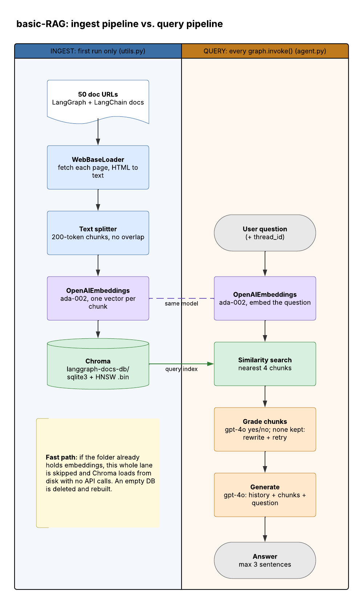
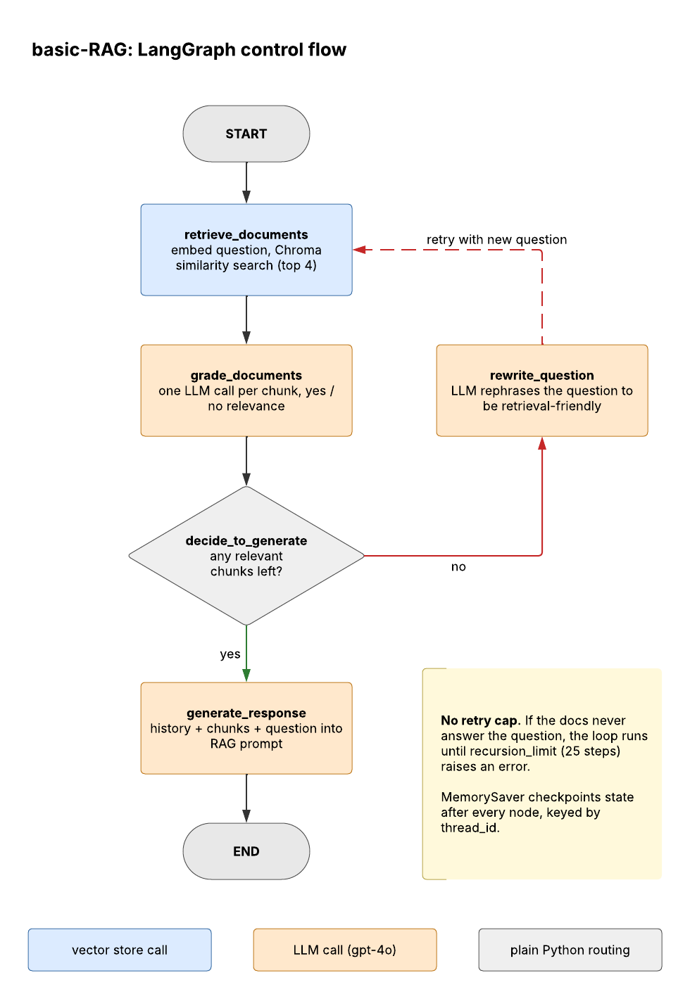
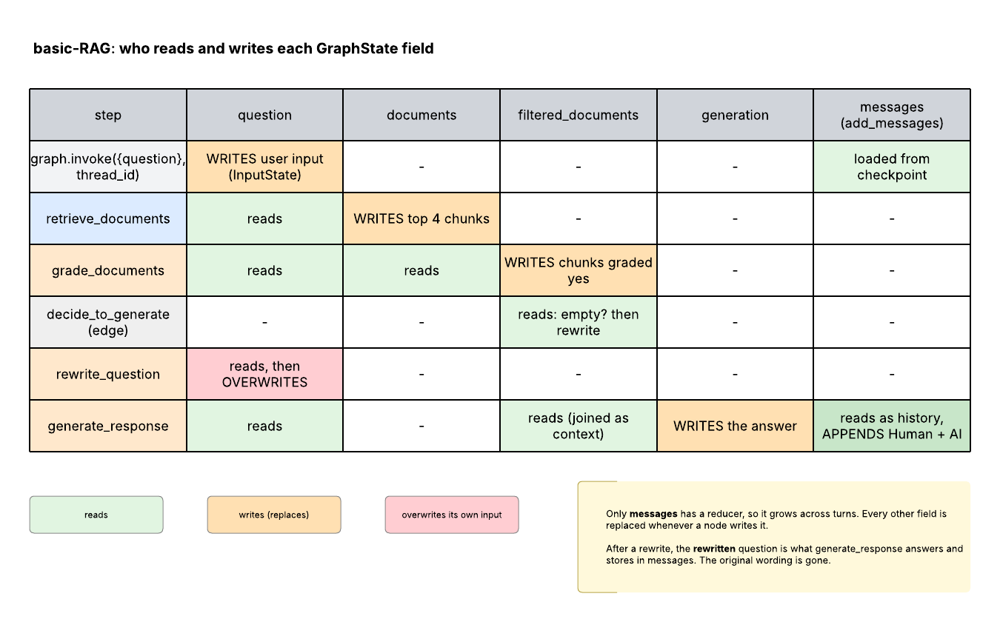
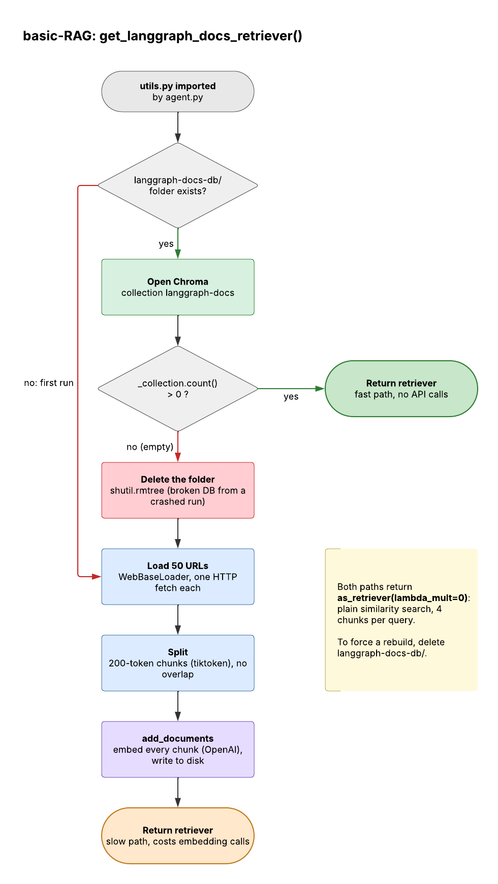
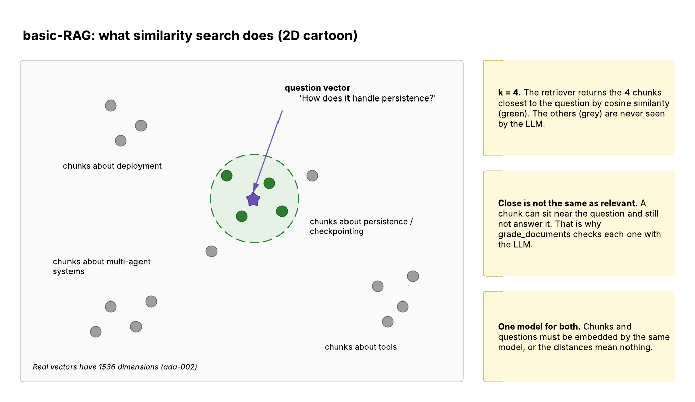
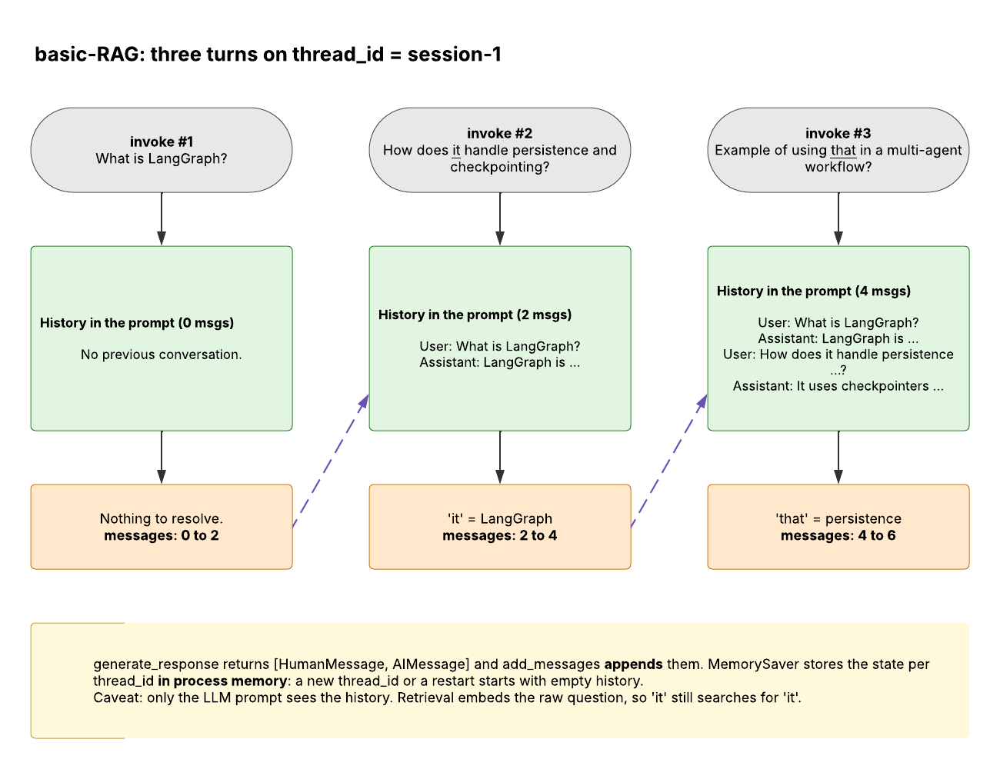
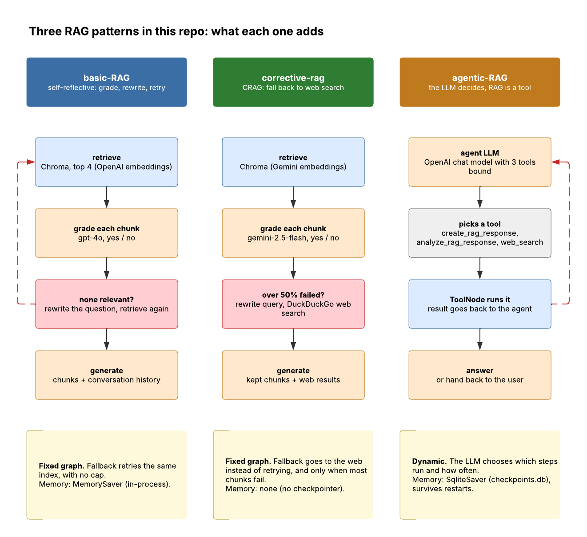
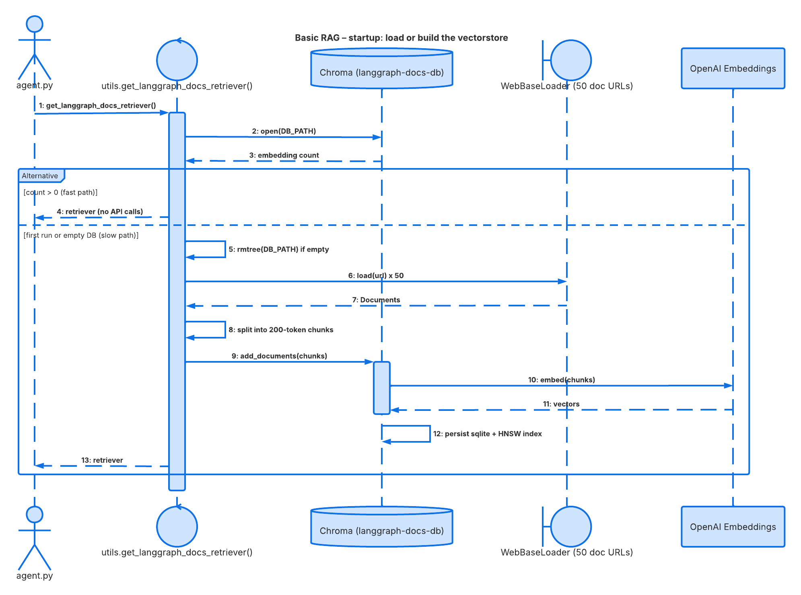
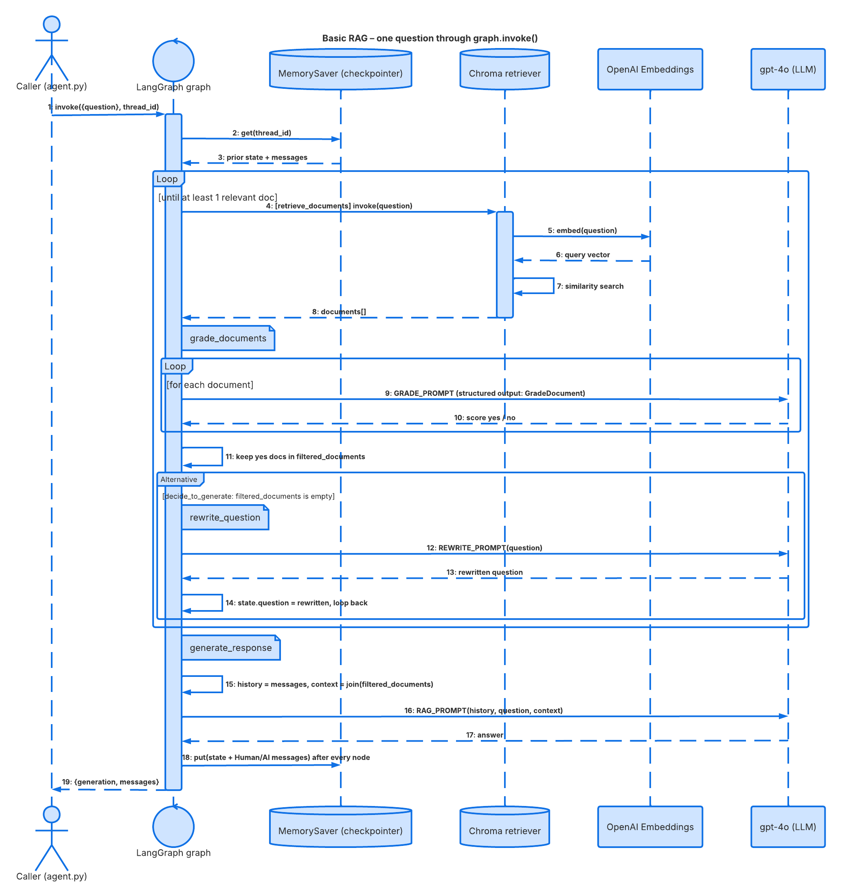

# Self-RAG Agent with Conversational Memory

A self-reflective RAG agent with conversational memory, built with LangGraph and leveraging Chroma's open-source vector database.

## Overview

This agent answers questions about LangGraph using a self-reflective RAG pattern — it retrieves documentation chunks, grades each one for relevance, and rewrites the question and retries if the retrieved docs are not useful. Conversation history is persisted across turns via LangGraph's checkpointing, so follow-up questions resolve correctly.

## Project Structure

```
basic-RAG/
├── agent.py          # LangGraph graph definition and entry point
├── utils.py          # Vectorstore setup, LLM, and retriever
├── requirements.txt  # Python dependencies
└── .env              # API keys (not committed)
```

## How it works

### `agent.py`

**1. Startup**

When the file loads it does 3 things in order:
- Loads `.env` so API keys are available
- Registers Phoenix tracing — from this point every LangChain/LangGraph call is automatically recorded
- Calls `get_langgraph_docs_retriever()` from `utils.py` — loads the vectorstore from disk (or builds it on first run)

**2. State**

The graph passes a state dict between nodes — shared memory for the current run:

```
GraphState
├── question            → the user's input question (may be rewritten)
├── documents           → raw chunks retrieved from the vectorstore
├── filtered_documents  → only the chunks that passed relevance grading
├── generation          → the LLM's final answer
└── messages            → full conversation history (auto-appended via add_messages reducer)
```

`InputState` restricts what the caller needs to provide — just `question`. The other fields get filled in as the graph runs.

The `messages` field uses the `add_messages` reducer — instead of overwriting on each turn, it appends new messages, preserving the full conversation history across invocations.

**3. Node 1 — `retrieve_documents`**

- Reads `question` from state
- Calls `retriever.invoke(question)` — embeds the question and finds the most similar chunks in Chroma
- Returns `{"documents": [...]}` merged into state

**4. Node 2 — `grade_documents`**

- Iterates over each retrieved document
- For each doc, calls the LLM with a structured output schema (`GradeDocument`) that returns `yes` or `no`
- Keeps only the relevant docs in `filtered_documents`
- Irrelevant docs are discarded

**5. Conditional edge — `decide_to_generate`**

- If `filtered_documents` is non-empty → proceed to `generate_response`
- If empty → proceed to `rewrite_question` and loop back

**6. Node 3 — `rewrite_question`**

- Only reached when all retrieved docs were irrelevant
- Calls the LLM to rephrase the question to be more retrieval-friendly
- Updates `question` in state, then loops back to `retrieve_documents`

**7. Node 4 — `generate_response`**

- Reads `question`, `filtered_documents`, and `messages` from state
- Formats conversation history as `User: ... / Assistant: ...` lines
- Joins relevant chunks into one context string
- Fills the RAG prompt (which includes history, context, and question) and calls the LLM
- Appends the current `HumanMessage` and `AIMessage` to `messages` for future turns
- Returns `{"generation": ..., "messages": [...]}` into state

**8. Conversational memory**

The graph is compiled with `MemorySaver()` as the checkpointer. On every `graph.invoke()` call, LangGraph saves the full state to memory keyed by `thread_id`. The next call with the same `thread_id` loads the prior state — including `messages` — so the LLM has full context of the conversation:

```python
config = {"configurable": {"thread_id": "session-1"}}

graph.invoke({"question": "What is LangGraph?"}, config=config)
graph.invoke({"question": "How does it handle persistence?"}, config=config)
# "it" correctly resolves to LangGraph from prior turn
graph.invoke({"question": "Can you give an example?"}, config=config)
# "that" correctly resolves to persistence from prior turn
```

**9. Graph wiring**

```
START → retrieve_documents → grade_documents → decide_to_generate
                                                   ├── relevant → generate_response → END
                                                   └── irrelevant → rewrite_question → retrieve_documents (loop)
```

**10. Entry point**

Only runs when executed directly (`python agent.py`). Runs 3 follow-up questions on the same `thread_id` to demonstrate conversational memory.

### `utils.py`

Contains all setup logic and one function:

**Module-level setup (runs on import)**

- `DB_PATH` — absolute path to the vectorstore folder, always resolved relative to `utils.py` regardless of where you run the script from
- `llm` — a `gpt-4o` client with `temperature=0` (deterministic answers)
- `embedding_model` — OpenAI embeddings client (`text-embedding-ada-002`) used to convert text into vectors
- `LANGGRAPH_DOCS` — list of 50 documentation URLs (LangGraph + LangChain) that form the knowledge base

**`get_langgraph_docs_retriever()`**

Has two execution paths:

- **Fast path (DB exists):** Loads Chroma from disk, verifies it has embeddings, and returns the retriever immediately with no API calls
- **Slow path (first run):** Fetches each URL via `WebBaseLoader`, splits content into 200-token chunks with `RecursiveCharacterTextSplitter`, embeds each chunk via OpenAI, persists to disk, then returns the retriever

If the DB exists but is empty (e.g. a previous run crashed mid-way), it automatically deletes the broken DB and rebuilds.

`as_retriever(lambda_mult=0)` returns a retriever that finds the most similar chunks by pure cosine similarity when given a question.

### Vectorstore (Chroma)

Chroma uses two storage mechanisms:

- `chroma.sqlite3` — stores document text, metadata, and collection info
- `*.bin` files — binary HNSW index for fast vector similarity search

## Diagrams

### Ingest pipeline vs. query pipeline

RAG has two phases. Ingest runs once and turns the docs into vectors in Chroma. Query runs on every question and searches those vectors. Both use the same embedding model, so the question and the chunks end up in the same vector space. That shared space is what makes similarity search meaningful.



[Edit in Lucidchart](https://lucid.app/lucidchart/a865216f-93fd-4a81-83fe-9cfe58d6ae4a/edit)

### Graph control flow

The four nodes and the `decide_to_generate` branch. Colours show what each step costs: a vector store call, an LLM call, or plain Python.



[Edit in Lucidchart](https://lucid.app/lucidchart/47447b3d-9ebd-43c0-8cbd-9fc4648d7205/edit)

### GraphState: who reads and writes what

Each node returns only the fields it changes, and LangGraph merges them into the shared state. `messages` is the only field with a reducer, so it is the only one that accumulates.



[Edit in Lucidchart](https://lucid.app/lucidchart/ac6a2dc6-327a-491e-a044-5d8379a5065b/edit)

### Retriever setup: fast path vs. slow path

What `get_langgraph_docs_retriever()` decides at import time, including the self-healing case where a crashed earlier run left an empty DB behind.



[Edit in Lucidchart](https://lucid.app/lucidchart/13881828-6e7f-43de-864f-1b971c3feab9/edit)

### What similarity search does

A 2D cartoon of the vector space. The question becomes a point, and the retriever returns the 4 nearest chunks. Being nearby doesn't guarantee a chunk is useful, so the grader checks each one.



[Edit in Lucidchart](https://lucid.app/lucidchart/ec86c403-85f8-4f40-aa09-786962e781a1/edit)

### Conversational memory across turns

The three questions from `python agent.py` on one `thread_id`. `messages` grows by two per turn, which is how "it" and "that" get resolved. Only the generation prompt sees the history: retrieval still embeds the raw follow-up question.



[Edit in Lucidchart](https://lucid.app/lucidchart/9bd67bf7-1fad-44cb-a898-655f30530838/edit)

### How basic-RAG compares to the other RAG agents in this repo

All three answer from a vector store. They differ in what happens when retrieval isn't good enough, and in who decides the steps: fixed graph edges or the LLM.



[Edit in Lucidchart](https://lucid.app/lucidchart/f56398fd-8fb1-4ed7-9f1e-4cb48c91b4a5/edit)

## Sequence diagrams

### Startup — building or loading the vectorstore

Runs once when `agent.py` imports `utils.py`. The fast path makes no API calls; the slow path scrapes, chunks and embeds the docs, then persists them.



[Edit in Lucidchart](https://lucid.app/lucidchart/52483002-bbde-48a5-ad45-05468087e67f/edit)

### One question — `graph.invoke()`

The loop retries until grading keeps at least one document. There is no retry cap, so a question the docs can't answer keeps rewriting until LangGraph's `recursion_limit` (default 25) stops the run with an error. The checkpointer saves state after every node, not only at the end.



[Edit in Lucidchart](https://lucid.app/lucidchart/a7c2eaf6-aecd-42b3-bfe2-10e978090864/edit)

## Setup

1. Install dependencies:
```bash
pip install -r requirements.txt
```

2. Create a `.env` file:
```
OPENAI_API_KEY=sk-...
PHOENIX_API_KEY=...
PHOENIX_COLLECTOR_ENDPOINT=https://app.phoenix.arize.com/...
```

3. Run the agent:
```bash
python agent.py
```

On first run the vectorstore will be built by scraping the documentation URLs — this requires OpenAI API calls for embeddings. Subsequent runs load from disk instantly.

## Observability

Phoenix tracing is enabled via `arize-phoenix-otel` and `openinference-instrumentation-langchain`. All LLM calls, retrievals, and graph steps are automatically traced and visible in your Phoenix dashboard.
